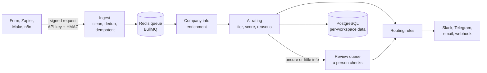

# LeadPilot

AI lead filtering and hand-over. Leads arrive from forms, Zapier, Make or n8n; LeadPilot cleans and de-duplicates them, rates each one Hot, Warm, Cold or Junk against your ideal customer with an LLM (and says why), and sends the good ones to the tools a team already uses: Slack, Telegram, email or any webhook. It does not replace a CRM or manage a sales team: it removes the junk and hands over the rest. Multi-tenant from day one, English and Vietnamese, dark and light.

[](https://github.com/Neronmen/Lead_Pilot/actions/workflows/ci.yml)

## Try it in five minutes

Needs Node 24, pnpm 12 and Docker Desktop. No API key, no card: the demo uses a free built-in mock AI and nothing leaves your machine.

```bash
cp .env.example .env
docker compose up -d
pnpm install
pnpm --filter api db:migrate
pnpm --filter api seed      # a demo workspace with 40 made-up leads
pnpm dev                    # web on :3000, API on :3001, mail in Mailpit on :8025
```

Open http://localhost:3000 and sign in with **demo@leadpilot-demo.com** / **demo-leadpilot-2026** (or set `NEXT_PUBLIC_DEMO_LOGIN=on` in `.env` for an "Explore the demo workspace" button). Then:

1. **Overview**: leads received, junk filtered out, time to first rating, leads by rating.
2. **Leads** and **Review queue**: ratings with plain reasons; leads the AI is unsure about wait for a person.
3. **Settings > Routing rules**: "Test with a sample lead" shows which rule decides and why. **Integrations**: connect Slack (any `https://hooks.slack.com/...` address works in mock mode).
4. **Settings > Lead sources**: "Send a sample lead", then watch it get rated and handed over (open the lead to see what the rules did; the alert email is in Mailpit).

## How it works



- **Safe by default.** Every query on tenant data is scoped to a workspace in one place (`TenantPrisma`), with database-level composite keys behind it and a test that every endpoint refuses another workspace's ids. Secrets are encrypted (AES-256-GCM) and shown once. Outgoing calls only reach public https addresses.
- **Honest AI.** Each rating records the prompt version, model, tokens and cost. A lead with little information is never rated Hot and goes to a person. A monthly spend limit falls back to simple rules. Prompts are measured with `pnpm eval` on a labelled set, tuned on one part and checked once on a held-out part (see [docs/pipeline.md](docs/pipeline.md)).
- **Reliable hand-over.** Each action is a queued job: retried with growing waits, dead after the last try, visible and retryable from the lead page. Routing the same lead twice never sends twice.

## What it deliberately does not do

- It is not a CRM and does not assign work to a sales team: the customer hands leads over inside their own tools. (The data model keeps owners, teams and roles; the screens for them are hidden. See [docs/design-notes.md](docs/design-notes.md).)
- No billing or plans, no single sign-on, no WebGL landing animation (see [docs/backlog.md](docs/backlog.md)).
- Real calls are off by default (`ACTIONS_MODE=mock`, `LLM_PROVIDER=auto` without a key): turn them on only with services that have a free tier.

## Deploying

One server, one command: `deploy/docker-compose.yml` runs the API, the web app, PostgreSQL, Redis and Caddy (automatic HTTPS). See [docs/deploy.md](docs/deploy.md) for the steps, real email, real AI, backups and what to tell customers.

## Stack

| Area | Choice |
|---|---|
| Monorepo | pnpm workspaces + Turborepo |
| API (`apps/api`) | NestJS 12, Prisma 7 + PostgreSQL 18, Redis 8 (BullMQ), zod, pino, Swagger |
| Web (`apps/web`) | Next.js 16 (App Router), Tailwind CSS 4, shadcn/ui, TanStack Query, next-intl (EN/VI), next-themes (dark/light) |
| Shared (`packages/shared`) | zod schemas and types used by both apps |
| Tests | Jest + Supertest (unit and e2e against real Postgres/Redis), Vitest (web unit), Playwright + axe (web render and accessibility checks), Node test runner for `shared` |
| CI | GitHub Actions: format, lint, typecheck, unit, e2e, build, browser render checks (Playwright + axe) |

## Getting started

Requirements: **Node 24** (see `.nvmrc`), **pnpm 12** (`corepack enable` or install it globally) and **Docker Desktop**.

```bash
cp .env.example .env          # defaults match docker-compose.yml
docker compose up -d          # postgres, redis, mailpit
pnpm install
pnpm --filter api db:migrate  # create the database schema
pnpm dev                      # api + web in watch mode
```

| URL | What |
|---|---|
| http://localhost:3000 | Web app |
| http://localhost:3000/status | Internal status page (API liveness and readiness) |
| http://localhost:3001/docs | API docs (Swagger UI); JSON at `/docs-json` |
| http://localhost:3001/health/ready | Readiness probe (Postgres + Redis) |
| http://localhost:8025 | Mailpit, catches all outgoing email locally |

Optional: `docker compose --profile n8n up -d` also starts n8n on http://localhost:5678 for testing outgoing webhooks.

No API keys are needed: without them the app runs in demo mode with mock providers (required by the spec from M3 on).

Invite emails go to Mailpit (http://localhost:8025) because `.env.example` sets `SMTP_HOST=localhost`. With `SMTP_HOST` empty the app keeps them in memory only (demo mode), so you could not open the invite link: keep it set while developing.

### Environment

`.env.example` documents every variable. The ones you may want to change:

| Variable | Default | Notes |
|---|---|---|
| `JWT_ACCESS_SECRET` | dev value | Required in production (32+ characters). The dev value is refused when `NODE_ENV=production`. |
| `ENCRYPTION_KEY` | dev value | Required in production: 32 random bytes in base64 (generate: `node -e "console.log(require('crypto').randomBytes(32).toString('base64'))"`). Encrypts signing secrets in the database. The dev value is public: it is refused in production, so never run a shared or staging server with `NODE_ENV=development`. Losing or changing the key makes stored signing secrets unreadable (switch signing off and on again). |
| `QUEUE_WORKERS` | `on` | `on` runs the background workers (scoring, clean-up) inside the API; `off` only queues jobs. |
| `ENRICHMENT_PROVIDER` | `mock` | `mock` (made-up company info, no network) or `website` (reads the company homepage; public addresses only). |
| `LLM_PROVIDER`, `LLM_MODEL`, `ANTHROPIC_API_KEY`, `OPENAI_API_KEY` | `auto`, mock | With no key the free built-in mock rates the leads. Set a key to use a real model; the key is never logged or returned. |
| `AUTH_RATE_LIMIT_PER_MINUTE` | 10 | Sign-up, sign-in and accept-invite requests per IP |
| `AUTH_REFRESH_RATE_LIMIT_PER_MINUTE` | 60 | Token refresh runs on every page load, so it has its own budget |
| `INVITE_RATE_LIMIT_PER_MINUTE` / `_PER_DAY` | 5 / 30 | Invite and resend requests per workspace (each sends email) |
| `SMTP_HOST`, `SMTP_PORT`, `EMAIL_FROM` | Mailpit | The SMTP provider has no authentication or TLS yet: Mailpit only |

The rate limiter counts in memory, per API instance; it moves to Redis in M3.

## Commands

| Command | What it does |
|---|---|
| `pnpm dev` | Run api (:3001) and web (:3000) in watch mode |
| `pnpm build` | Build every package |
| `pnpm lint` / `pnpm typecheck` | ESLint / TypeScript across the repo |
| `pnpm format` / `pnpm format:check` | Prettier write / check |
| `pnpm test` | All unit tests |
| `pnpm test:e2e` | API e2e tests against the `leadpilot_test` database (Docker must be up: they also use Redis and Mailpit) |
| `pnpm test:render` | Web render checks in a real browser with a mocked API (no Docker): dark/light × EN/VI, accessibility rules, every page state. First run: `pnpm --filter web exec playwright install chromium`. Writes screenshots and `apps/web/e2e/results.md` |
| `pnpm --filter web icons` | Re-render the PNGs and app icons from the logo SVGs in `design/brand/` |
| `pnpm --filter @leadpilot/shared tlds` | Regenerate the list of real top-level domains used to check email addresses (after upgrading the `tlds` package) |
| `pnpm --filter api db:migrate --name <name>` | Create and apply a migration after editing `schema.prisma` |
| `pnpm --filter api db:deploy` | Apply pending migrations (CI, production) |
| `pnpm --filter api db:generate` | Regenerate the Prisma client (Turbo runs it automatically) |

## Project layout

```
apps/
  api/                 NestJS API
    prisma/            schema.prisma + migrations
    src/
      common/          error filter, DomainError, logging config, zod validation pipe
      config/          zod-validated environment
      health/          /health/live and /health/ready
      auth/            sign-up, sign-in, refresh tokens, guards (JWT, roles), rate limits
      invites/         invite people by email, accept an invite
      members/         the team: list, change role, remove
      audit/           change history (who changed what, before and after)
      email/           EmailProvider (SMTP, mock) and the React Email templates
      prisma/          PrismaService (driver adapter) and the workspace-scoped client
      redis/           shared Redis client
    test/              e2e tests (Jest + Supertest)
  web/                 Next.js app
    app/               pages: login, signup, invite, (app)/leads, (app)/settings/team, status
    components/        auth forms, app shell, team page, shadcn/ui components (ui/)
    lib/               auth client (token in memory, cross-tab refresh lock), i18n, team rules
    messages/          English and Vietnamese texts (every string goes through them)
    e2e/               Playwright render checks and the mocked API
packages/
  shared/              zod schemas and error codes shared by api and web (auth, team, errors)
design/brand/          logo SVGs and the PNGs generated from them
infra/postgres/init/   creates leadpilot_test on first start
docker-compose.yml     local infrastructure
docs/                  design notes, backlog, error-handling guide
```

- How errors look and how to add one: [docs/error-handling.md](docs/error-handling.md).
- What happens to a lead after it arrives (queue, company info, AI rating, review, evals): [docs/pipeline.md](docs/pipeline.md).
- Sending leads in (`POST /v1/ingest/:sourceId`: API key, optional HMAC signature, Idempotency-Key) and how duplicates are handled: [docs/dedup.md](docs/dedup.md). Lead sources and the API key / signing secret live in Settings > Lead sources and Advanced / Developer.
- Multi-tenancy: every tenant query goes through `TenantPrisma.for(workspaceId)`, composite foreign keys keep related rows in one workspace, and `apps/api/test/isolation.e2e-spec.ts` fails if an endpoint is not classified and tested across workspaces.

## Using a real AI model

With no key the app rates leads with a free built-in mock, so the demo, the tests and CI cost nothing. To
use a real model, put ONE key in `.env` (never commit it; the app never logs or returns it):

| Variable | Effect |
| --- | --- |
| `ANTHROPIC_API_KEY` | `LLM_PROVIDER=auto` then uses Anthropic (default model `claude-haiku-5-5`). |
| `OPENAI_API_KEY` | Used if no Anthropic key is set (default model `gpt-4o-mini`). |
| `GEMINI_API_KEY`, `GEMINI_PAID_TIER` | Used if neither of the above is set; see the Gemini section below. |
| `LLM_PROVIDER` | `auto` (default), `mock`, `anthropic`, `openai` or `gemini`. `mock` forces the free mock even if a key is set. |
| `LLM_MODEL` | Optional. Use a model that is in the price table in `apps/api/src/scoring/llm.provider.ts`, or its cost is estimated high. |
| `AI_DEFAULT_MONTHLY_LIMIT_USD` | Monthly spend allowed for a workspace that set no limit (default 5; `0` = none). Over it, leads are rated by simple rules and still saved. |

### Gemini (Google)

Set `LLM_PROVIDER=gemini` (or just `GEMINI_API_KEY` with `auto`), put the key in `.env` yourself, and pick a model
with `LLM_MODEL` (default `gemini-2.5-flash-lite`; for example `gemini-3.5-flash-lite`). The key is sent in a
header only and is never logged. Gemini is tracked as **$0** because the free tier has no charge; on a paid
tier add the model and its prices to the table in `llm.provider.ts`.

**Free-tier limits.** Gemini Flash-Lite's free tier allows about 15 calls a minute and 500 a day. Set
`LLM_MAX_REQUESTS_PER_MINUTE=12` in `.env`: calls then wait their turn (in this process) instead of being refused
and falling back to the rules. At 12 a minute `pnpm eval` (50 leads) takes about 4-5 minutes and uses 10% of the day.

> **WARNING: the free tier is for fake or demo data only.** On Google's free tier, Google may use what you
> send to improve its products. Never send real customer leads through a free-tier key. For real customers use
> a **paid tier** (then set `GEMINI_PAID_TIER=true`) or a provider that does not train on your data. In
> production, running Gemini without `GEMINI_PAID_TIER=true` logs a warning at startup.

**What it costs.** One lead is about 700 tokens in and 120 out. `pnpm eval` rates 50 leads, so one run is about
**$0.07** with `claude-haiku-5-5` and about **$0.01** with `gpt-4o-mini` (twice that with `--candidate`, which runs a
second prompt). These are estimates from the price table in the code, not a bill: check the provider's prices.

**About the 94%.** `pnpm eval` prints 94% with no key. That is the **rules baseline** (the mock answers with the
rule-based score) on a small hand-labelled demo set, **not an AI result**. The Anthropic and OpenAI adapters have
only been tested with a fake `fetch`: run `pnpm eval` with your own key to get a real number, and replace the demo
labels with the corrections people make in the Review queue when you have enough.

## Conventions worth knowing

- **One error shape.** Every API error is `{ "error": { "code", "message", "details"? } }`, built in a single global filter. Unexpected errors never leak internals.
- **Request ids.** Each response carries `x-request-id`, and every log line includes it.
- **Live vs ready.** `/health/live` only says the process is up; `/health/ready` checks Postgres and Redis and answers 503 when one is down. Orchestrators restart on the first and stop routing traffic on the second.
- **Tenancy.** Every tenant table has `workspaceId`; from M1 all queries go through a workspace-scoped helper.
- **Safe tests.** e2e tests refuse to run unless the target database name ends in `_test`.

- **Local only.** Docker services listen on `127.0.0.1` only, because they use development credentials.

Project rules for contributors (and Claude Code) live in [CLAUDE.md](CLAUDE.md). Decisions deferred to later milestones are tracked in [docs/backlog.md](docs/backlog.md).
